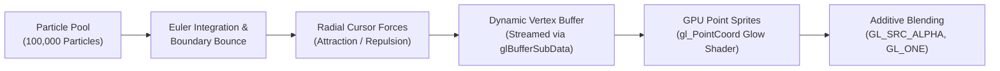

# Particle Simulator

[](https://en.wikipedia.org/wiki/C%2B%2B17)
[](https://www.opengl.org)
[](https://cmake.org)
[](LICENSE)

An interactive, high-performance 2D particle simulation laboratory engineered in modern C++17 and OpenGL 3.3 Core Profile. Simulates **100,000+ interactive particles** simultaneously with dynamic alpha dissipation, radial force physics, and point-sprite fragment glow.

---

## Architecture & Rendering Pipeline



---

## Key Features

- **Massive Particle Scale:** Simulates 100,000 individual particles rendered at 60+ FPS using OpenGL point primitives.
- **Hardware-Accelerated Point Sprites:** Employs `GL_PROGRAM_POINT_SIZE` and fragment-shader `gl_PointCoord` analytical distance calculations for smooth circular glows and Gaussian falloffs.
- **Interactive Radial Dynamics:** Real-time inverse-distance mouse attraction and spacebar repulsive blast waves.
- **Kinematic Particle Lifecycle:** Dynamic lifetime decay, speed-clamping, particle respawning, and elastic boundary collisions.
- **Zero Heap Overhead in Hot Loop:** Preallocated vertex arrays streamed directly to GPU buffers via `glBufferSubData`.
- **Self-Contained Architecture:** Standalone project with bundled GLAD loader; zero external repo dependencies.

---

## Technical Highlights

- **Modern C++17 Standards:** Employs `<random>` (`std::mt19937`) for uniform distribution and cache-friendly contiguous data layouts.
- **Additive Blend Blitting:** Uses `glBlendFunc(GL_SRC_ALPHA, GL_ONE)` to simulate intense volumetric light accumulation where particles cluster.
- **Robust Resource Management:** RAII-compliant Shader abstractions preventing GPU handle leaks on failed compilations.

---

## Controls

| Input | Action |
| :--- | :--- |
| **Mouse Cursor** | Attracts nearby particles within force radius |
| **Spacebar (Hold)** | Reverses force vector to repel particles violently |
| **Escape** | Cleanly terminates the application |

---

## Prerequisites

- **Compiler:** GCC 9+, Clang 10+, or MSVC 2019+ (C++17 support)
- **Build System:** CMake 3.20+
- **Windowing Library:** GLFW 3 (`sudo pacman -S glfw` or `sudo apt install libglfw3-dev`)
- **OpenGL:** Development headers (`libgl-dev` or mesa)

---

## Build & Run

```bash
# Clone and enter directory
cd ParticleSimulator

# Generate build configuration
cmake -B build -S . -DCMAKE_BUILD_TYPE=Release

# Build executable
cmake --build build -j$(nproc)

# Run simulation
./build/ParticleSimulator
```

---

## License

Distributed under the [MIT License](LICENSE).
